# pettycourt — Group Chat Court: a mock trial for petty arguments

**Live:** https://pettycourt.1426davejobs.workers.dev (a Cloudflare Worker since 2026-11-08; BUILD.md, "Deploy on a free tier").

## On the live site (2026-11-08)

Taken in Chromium against https://pettycourt.1426davejobs.workers.dev, at 1280×800 and as an iPhone 13, during one real case: filed, answered, ruled on by the live judge and then deleted.

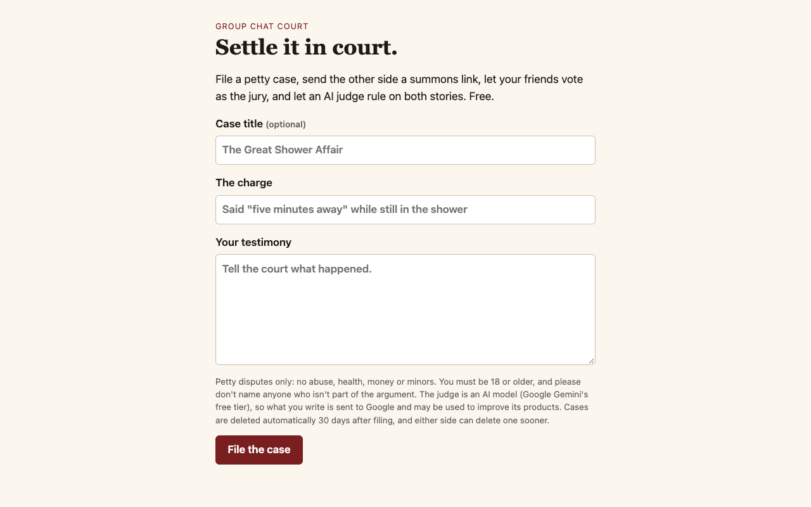
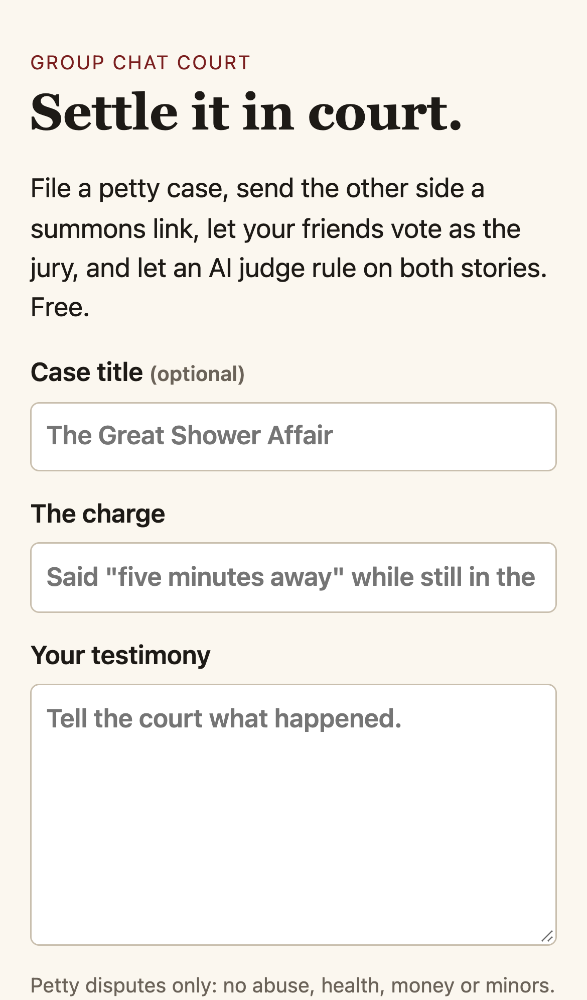
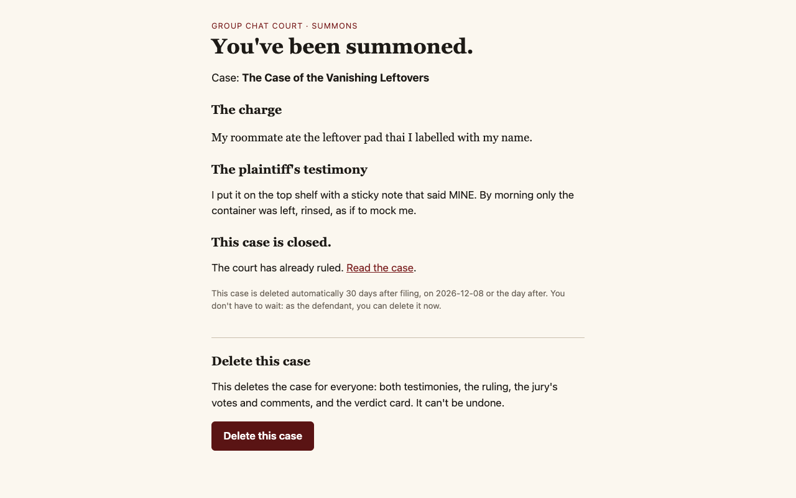
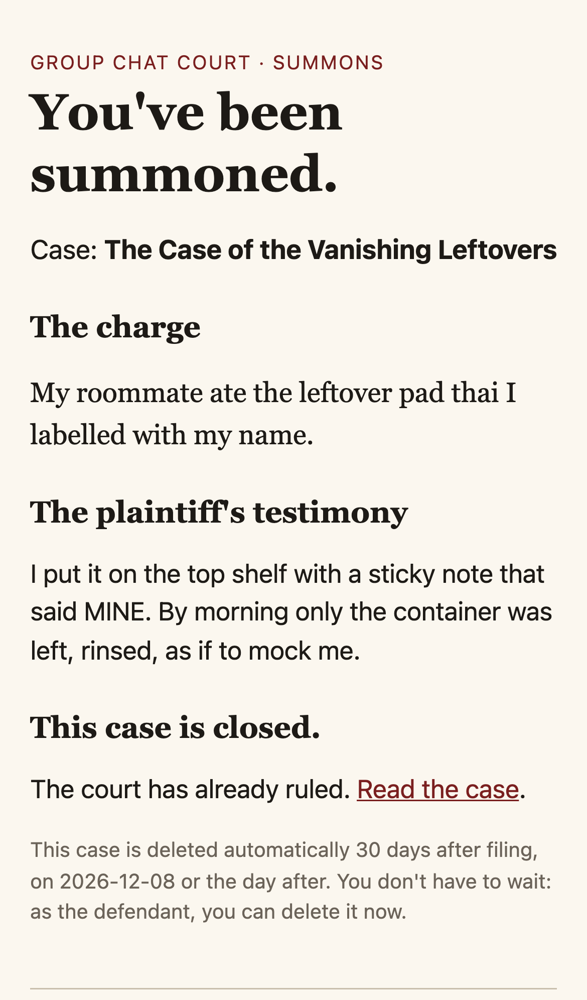
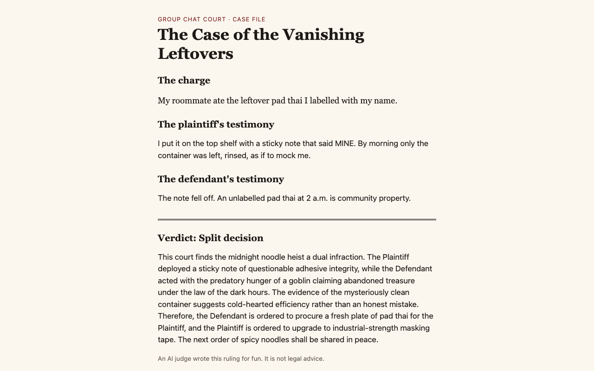
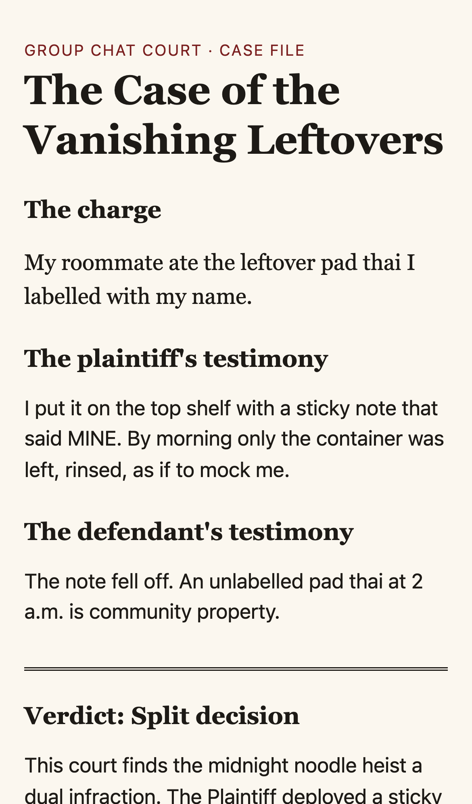

## Screenshots (local app)

Taken by `npm run screenshots` against the local app (stub judge, sample data, and a placeholder `STRIPE_PAYMENT_LINK` of https://example.com/pay), in Chromium at 1280×800 and as an iPhone 13, during one real trial with separate browsers for the plaintiff, the defendant and three jurors.

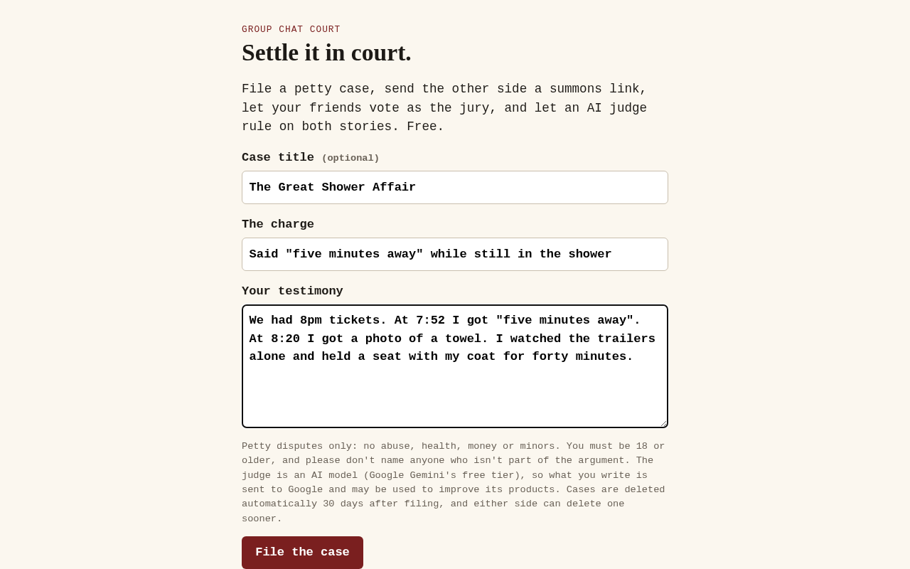
The start page: a plaintiff types in "The Great Shower Affair" and files it. Filing a case is the core action.

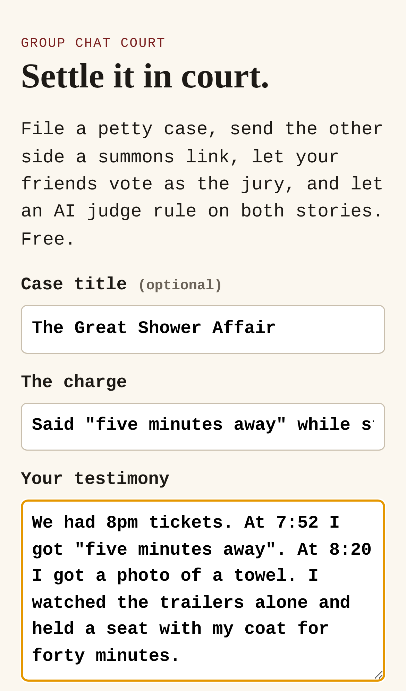
The filing form works on a phone.

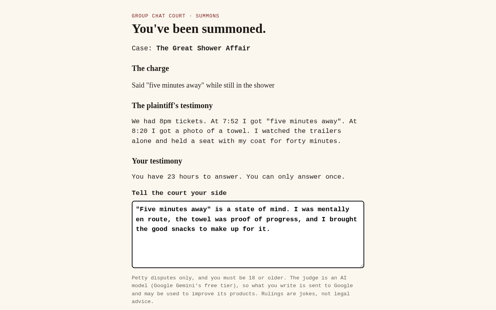
The other side opens the summons link, reads the charge and the plaintiff's testimony, and answers.

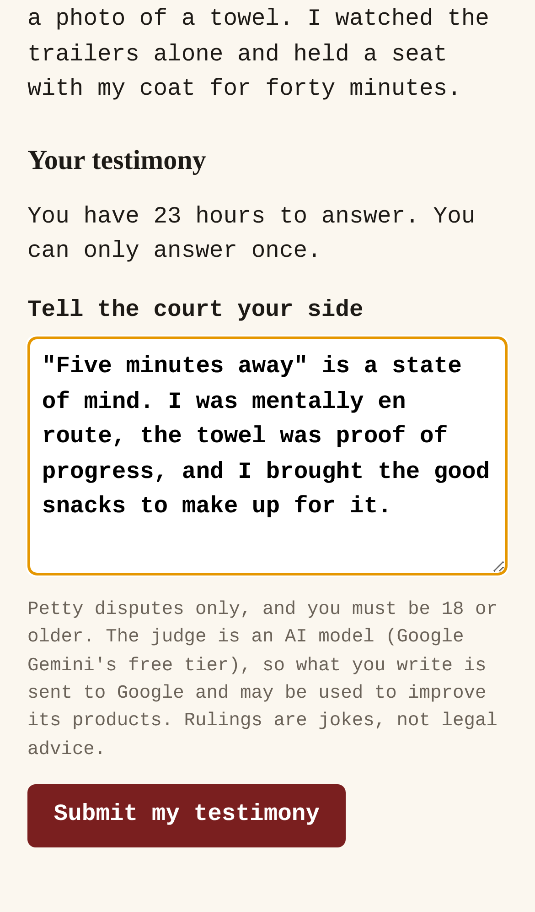
The defendant answers from a phone, the way a summons arrives from the group chat.

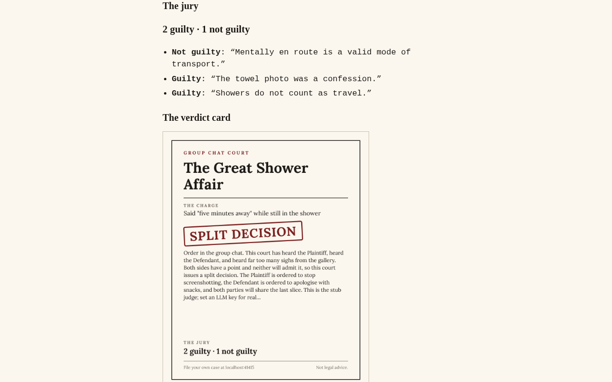
The result: the judge's split decision and the jury's 2–1 vote on the shareable verdict card, with the footer's Terms, Privacy and Contact links.

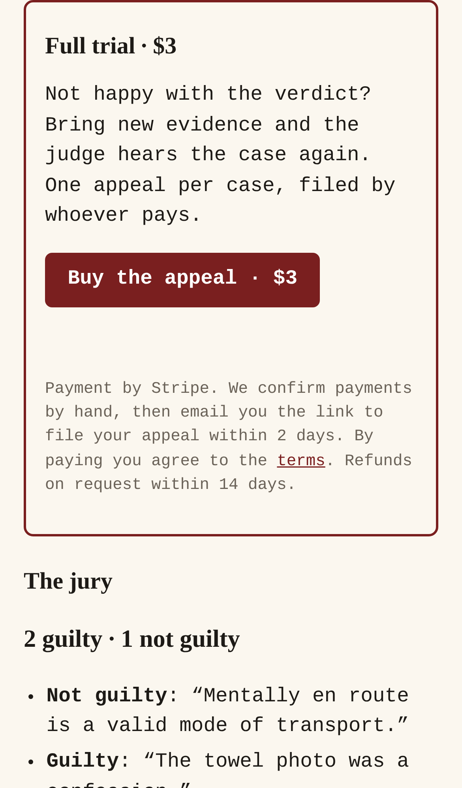
After the ruling, the "Buy the appeal · $3" button (shown because `STRIPE_PAYMENT_LINK` is set) sits above the jury's 2–1 split and comments.

For friends, couples and roommates in a petty dispute, it turns the argument into a summons link, a friend jury and an AI judge's funny ruling on a shareable card, and the invite brings the other side in.

- [Research](RESEARCH.md) — findings and sources
- [PRD](PRD.md)
- [Roadmap](ROADMAP.md)
- [Build notes](BUILD.md): what's built, how to run, test and deploy it
- [Launch readiness](LAUNCH-READY.md): search and sharing, legal pages, the Buy button, launch counts, and what's left before launch

Effort: Low · Confidence: Low

_Researched by the idea pipeline on 2026-10-13 ([original record](https://github.com/smithdavedesign/idea-factory/tree/main/ideas/pettycourt)); repo created on David's go-ahead 2026-10-13._
