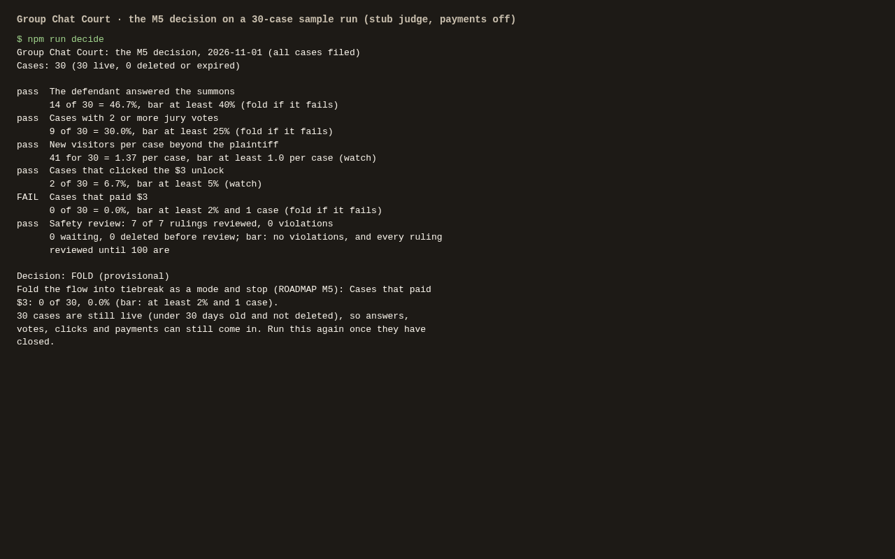
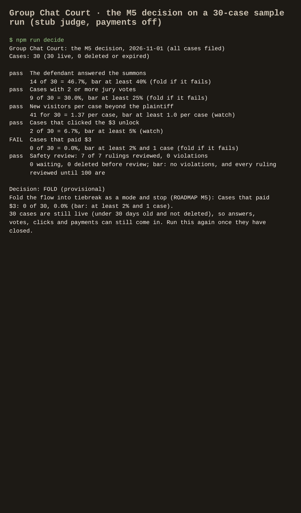

# pettycourt — Group Chat Court: a mock trial for petty arguments

## Screenshots

Taken by `npm run screenshots` against the local app (stub judge, sample data), in Chromium at 1280×800 and as an iPhone 13.

The start page: a plaintiff types in a case ("The Great Shower Affair") to file it.

The filing form works on a phone.

The result of a real trial in five separate browsers (plaintiff, defendant and three jurors): the defendant answered the summons, the jurors voted, and the judge ruled. The page shows the 2–1 jury split, the jurors' comments and the rendered verdict card.

The same result on a phone, the way jurors and the defendant open it from the group chat.

M5: `npm run decide` applies every PRD bar to 30 sample cases: the trial above (its 5 visitors counted by the page's beacon in real browsers) plus 29 filed through the API. Every ruling was safety-reviewed with `npm run decide -- ok`. Payments were off, so nobody paid and the roadmap's rule says fold.

The same decision report, 80 columns wide, on a phone.

For friends, couples and roommates in a petty dispute, it turns the argument into a summons link, a friend jury and an AI judge's funny ruling on a shareable card, and the invite brings the other side in.

- [Research](RESEARCH.md) — findings and sources
- [PRD](PRD.md)
- [Roadmap](ROADMAP.md)
- [Build notes](BUILD.md): what's built, how to run, test and deploy it

Effort: Low · Confidence: Low

_Researched by the idea pipeline on 2026-10-13 ([original record](https://github.com/smithdavedesign/idea-factory/tree/main/ideas/pettycourt)); repo created on David's go-ahead 2026-10-13._
